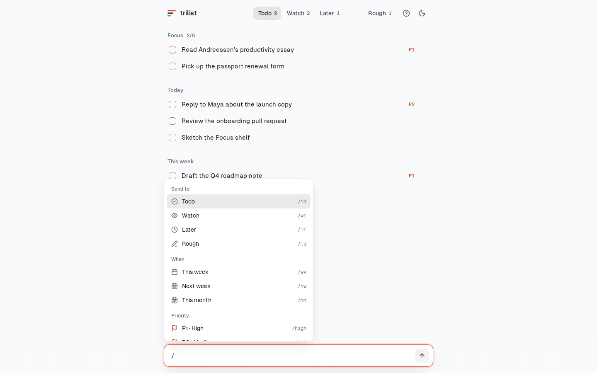
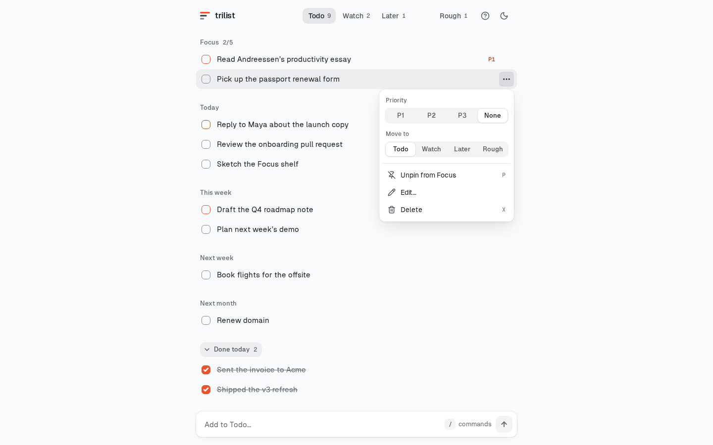
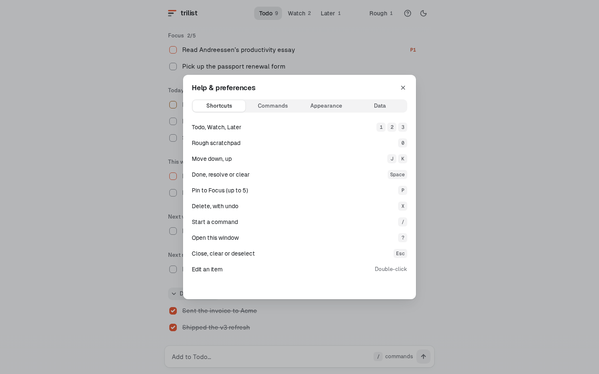
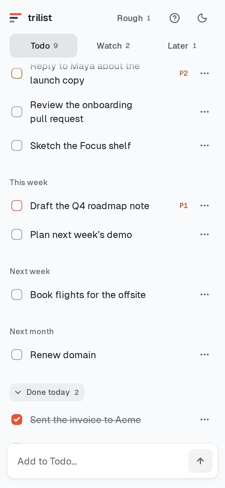
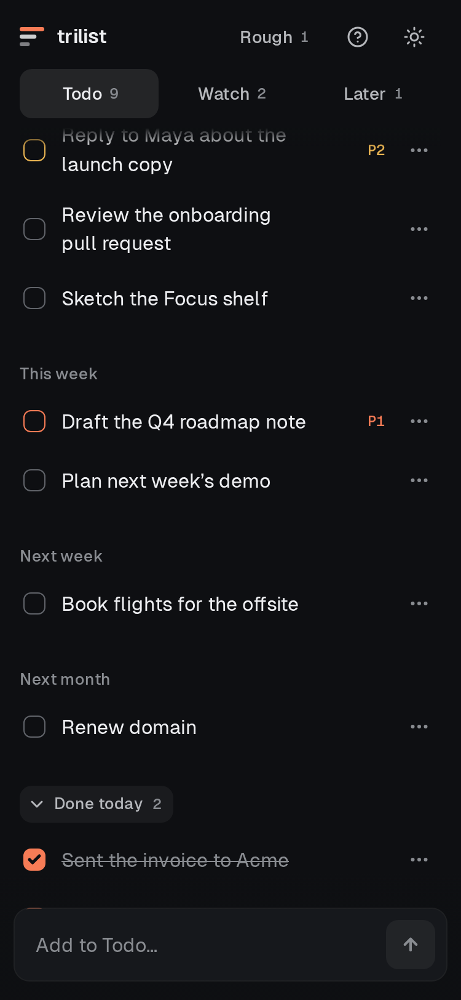

# Trilist

Minimalist, keyboard-first productivity app inspired by Marc Andreessen's 3-list system.

[](LICENSE)
[](https://react.dev/)
[](https://www.typescriptlang.org/)
[](https://vitejs.dev/)
[](https://oxc.rs/)
[](https://vercel.com/)


<details>
<summary>More screenshots</summary>

| Slash menu | Row menu | Help |
|---|---|---|
|  |  |  |

| Phone, light | Phone, dark |
|---|---|
|  |  |

</details>

---

## Table of contents

- [Motivation](#motivation)
- [Why Trilist?](#why-trilist)
- [The 3-list system](#the-3-list-system)
- [Features](#features)
- [Tech stack](#tech-stack)
- [Quick start](#quick-start)
- [Keyboard shortcuts](#keyboard-shortcuts)
- [Inline tags](#inline-tags)
- [Data privacy](#data-privacy)
- [Testing](#testing)
- [Contributing](#contributing)
- [Credits](#credits)
- [License](#license)

---

## Motivation

Most task management apps encourage giant backlogs. You create dozens of lists, tag everything, and watch tasks pile up until you abandon the app.

Trilist keeps your daily task focus manageable.

Inspired by Marc Andreessen's essay, [Guide to Personal Productivity](https://pmarchive.com/guide_to_personal_productivity.html), Trilist brings a fast, keyboard-first 3-list workflow to the web.

---

## Why Trilist?

| Traditional Productivity Tools | The Trilist Approach |
|---|---|
| Endless task backlogs that grow forever | Focused daily priorities |
| Cluttered dropdown menus | Fast inline tag routing (`/td`, `/wt`, `/lt`, `/p1`) |
| Mandatory sign-ups and cloud syncing | Instant offline IndexedDB with 100% local storage |
| Messy action buttons | One quiet `…` menu per row and small P1/P2/P3 tags |

---

## The 3-list system

Trilist structures your work into three core lists:

1. **Todo**: Your core tasks for today.
2. **Watch**: Radar items, including replies you're waiting on or projects you're tracking.
3. **Later**: Tasks scheduled for future weeks or months.

### Scratchpad

- **Rough**: A separate scratchpad space for quick notes and raw ideas before routing them to your core lists.

---

## Features

- **Inline tag routing**: Route tasks while typing by adding `/td`, `/wt`, `/lt`, or `/rg` anywhere in the input bar.
- **Todo timeframes**: Schedule with `/wk` (this week), `/nw` (next week), or `/mn` (next month). Todo groups itself into quiet Focus / Today / This week / Next week / Next month sections.
- **Focus pins**: Pin up to 5 items with `/pin`, the `P` key, or Pin in the `...` menu. They sit at the top under Focus.
- **Done today**: Ticked items sink into a collapsed **Done today** disclosure. `/did <text>` logs a win straight into it. Resets at local midnight; history stays in exports.
- **Watch ages**: Every Watch item shows how long it has waited (`today`, `2d`, `3w`).
- **Undo toasts**: Adding across lists, deleting, ticking, resolving, moving and importing all offer 5-second Undo — and adding never yanks you off your current tab.
- **Priority tags**: Set priority with `/p1` (coral), `/p2` (amber), or `/p3` (quiet). A small `P1` tag marks the row; click it, or use the `…` menu, to change it.
- **Row menu (`…`)**: Appears on hover or focus (always on touch) for pinning, priority, list moves, editing and deletion. A bottom sheet on phones.
- **Themes & typography**: Light (default) and dark themes from one token set, coral accent with a 5-colour picker, Geist Sans + Geist Mono, and a typeface picker (Geist, Inter, Serif, Mono).
- **Slash menu**: Type `/` for a keyboard-driven command list (↑ ↓ to move, Enter or Tab to pick, Esc to close).
- **Offline local storage**: Data stays in your browser using IndexedDB. Includes JSON export and import backups.
- **PWA**: Installable to the home screen with an offline service worker.

---

## Tech stack

- **Framework**: React 19 + TypeScript 6
- **Build tool**: Vite 8
- **Styling**: One small vanilla CSS design system (`src/styles/index.css`): OKLCH tokens, 3 surfaces, 3 text tones, radii 6/10/12, one easing
- **Animations**: Motion (`motion/react`)
- **Icons**: Lucide React
- **Database**: Browser IndexedDB API
- **Linter**: Oxlint

---

## Quick start

### Prerequisites

- Node.js v18.0 or higher
- npm v9.0 or higher

### Local setup

```bash
git clone https://github.com/Nishachay/Trilist.git
cd Trilist
npm install
npm run dev
```

Open [http://localhost:5173](http://localhost:5173) in your browser.

---

## Keyboard shortcuts

| Key | Action |
|---|---|
| `0` | Switch to **Rough** scratchpad |
| `1` | Switch to **Todo** list |
| `2` | Switch to **Watch** list |
| `3` | Switch to **Later** list |
| `j` / `k` | Navigate items up / down |
| `Space` | Toggle completion / resolve task |
| `p` | Pin row to Focus (holds 5) |
| `x` or `d` | Delete selected task (Undo offered) |
| `…` | Open the row menu |
| `/` | Focus input bar |
| `?` | Open Help and Preferences overlay |
| `Esc` | Clear input or close popovers |

---

## Inline tags

### Destination tags

- `/todo` or `/td`: Route task to **Todo**
- `/watch` or `/wt`: Route task to **Watch**
- `/later` or `/lt`: Route task to **Later**
- `/rough` or `/rg`: Route task to **Rough**

### Priority tags

- `/p1` or `/high`: High priority (coral)
- `/p2` or `/med`: Medium priority (amber)
- `/p3` or `/low`: Low priority (quiet)

### Date tags (work on every list, including Todo)

- `/week` or `/wk`: This week (7 days)
- `/nextweek` or `/nw`: Next week (14 days)
- `/month` or `/mn`: Next month (30 days)

### Action tags

- `/pin`: Pin the new item to Focus (up to 5)
- `/did <text>`: Log something you did straight into Done today

---

## Data privacy

Your tasks stay on your device:
- **Local storage**: Tasks save locally in your browser using IndexedDB. No external servers or user accounts required.
- **Backup and export**: Export your database as a `.json` backup file or restore from a previous file in the Preferences menu (`?`).

---

## Testing

Run linting and build commands locally:

```bash
npm run lint
npm run build
npm run preview
```

---

## Contributing

1. Fork the repository (`https://github.com/Nishachay/Trilist/fork`)
2. Create your feature branch (`git checkout -b feature/new-feature`)
3. Commit your changes (`git commit -m 'feat: add new feature'`)
4. Push to the branch (`git push origin feature/new-feature`)
5. Open a Pull Request

Run `npm run lint` before submitting code.

---

## Credits

Concept based on Marc Andreessen's 2007 essay, [Guide to Personal Productivity](https://pmarchive.com/guide_to_personal_productivity.html).

Built by Nishachay — [@ni5hachay on X](https://x.com/ni5hachay) · [GitHub](https://github.com/nishachay).

---

## License

This project is licensed under the MIT License. See [LICENSE](LICENSE) for details.
