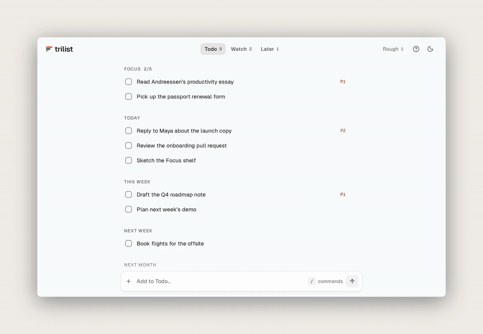

# Trilist

A calm, keyboard-first todo app built on Marc Andreessen's three lists: Todo, Watch, Later.

**[Try it at trilist.vercel.app](https://trilist.vercel.app/)** · [v2.0.0 release](https://github.com/nishachay/Trilist/releases/tag/v2.0.0) · [MIT License](LICENSE)


---

## Why

Most todo apps let the backlog grow forever. You add lists, tags and projects until the app becomes something else to manage.

In his [Guide to Personal Productivity](https://pmarchive.com/guide_to_personal_productivity.html), Marc Andreessen suggests keeping three lists and only three. If something doesn't belong on one of them, it goes away. Trilist is that idea as a fast, offline web app.

## The three lists

1. **Todo**: what you must do, grouped by Today, This week, Next week and Next month.
2. **Watch**: what you're waiting on or need to follow up, with how long each item has waited.
3. **Later**: everything else, for when you have time.

**Rough** is a scratchpad beside them for raw notes before they earn a place on a list.



---

## What's new in v2

- **Focus pins.** Pin up to 5 items with `/pin`, `P` or the `…` menu. They sit at the top of Todo.
- **Done today.** Ticked items collect in a Done today section, and `/did <text>` logs something you did without adding it first. It clears at local midnight, and exports keep the history.
- **Todo timeframes.** `/wk`, `/nw` and `/mn` file a task under This week, Next week or Next month.
- **Watch ages.** Every Watch item shows how long it has waited (`today`, `2d`, `3w`).
- **Undo.** Adding, ticking, deleting, moving and importing all offer a 5-second Undo.
- **Installable and offline.** Add it to your home screen, and it works without a connection.
- **A quieter redesign.** A flat single column, Geist type, one icon set and a new logo.

## Also in Trilist

- **Type-to-route**: add `/td`, `/wt`, `/lt` or `/rg` anywhere while typing to send a task to a list. Type `/` for the full command menu.
- **Priority**: `/p1`, `/p2` and `/p3` add a small P1/P2/P3 tag. Click the tag to change it.
- **Row menu (`…`)**: pin, set priority, move, edit or delete. It opens as a bottom sheet on phones.
- **Themes**: light and dark, five accent colours, and a choice of Geist, Inter, Serif or Mono.

---

## Keyboard shortcuts

| Key | Action |
|---|---|
| `1` `2` `3` | Todo, Watch, Later |
| `0` | Rough |
| `j` / `k` | Move down / up |
| `Space` | Tick or resolve the selected item |
| `p` | Pin to Focus (up to 5) |
| `x` or `d` | Delete (with Undo) |
| `/` | Focus the input bar |
| `?` | Help and preferences |
| `Esc` | Clear the input or close a menu |

## Slash commands

| Command | Does |
|---|---|
| `/todo` `/td` · `/watch` `/wt` · `/later` `/lt` · `/rough` `/rg` | Send to a list |
| `/p1` `/high` · `/p2` `/med` · `/p3` `/low` | Set priority |
| `/week` `/wk` · `/nextweek` `/nw` · `/month` `/mn` | Set a Todo timeframe |
| `/pin` | Pin to Focus |
| `/did <text>` | Log a win in Done today |

---

## Your data

Everything stays in your browser (IndexedDB). There are no accounts and no servers. You can export a `.json` backup, or restore one, from Preferences (`?`).

## Run it locally

Needs Node 20.19+ or 22.12+.

```bash
git clone https://github.com/nishachay/Trilist.git
cd Trilist
npm install
npm run dev        # http://localhost:5173
```

Before sending a PR, run `npm run lint` and `npm run build`. PRs are welcome.

Built with React 19, TypeScript, Vite 8, Motion and Lucide icons, with plain CSS tokens in `src/styles/index.css`.

---

Built by Nishachay · [@ni5hachay](https://x.com/ni5hachay) · [GitHub](https://github.com/nishachay)
